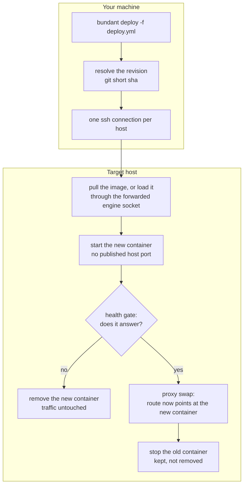

# Quick start

**What you get:** the `bundant` command installed, one host checked over ssh, and one service
running behind a proxy.

**Why it matters:** a deploy that replaces a container without dropping requests is usually a
platform project. Here it is one file and one command, and you can see every step it takes.

Three words come up on this page and everywhere after it:

- **revision** — the git short sha of the directory that holds `deploy.yml`; every deploy
  builds a container named after it, and rollback targets it.
- **health gate** — a probe that must answer before traffic moves; a new container that fails it
  is removed and the old one keeps serving.
- **proxy swap** — the single step that points the host's proxy at the new container. Until it
  happens, nothing user-visible changes.

## 1. Install the CLI

`bundant` is not on npm yet, so install it from a checkout. This builds the Node bundle and
links the command into Bun's global bin directory:

```sh
git clone https://github.com/gjuoun/bundant.git
cd bundant
bun install
bun run build
bun link
bundant --version
```

You should see `bundant v0.1.0`.

Bun users can also run `bundant-bun`, which executes the TypeScript sources directly and needs
no build step.

## 2. Write a deploy.yml

`deploy.yml` is the one file that describes a service: which image to run, which hosts run it,
and how HTTP traffic reaches it. Create a directory, write the file, and commit it:

```sh
mkdir -p ~/bundant-tutorial/app
cd ~/bundant-tutorial/app
git init

cat > deploy.yml <<'YAML'
version: 2
service: hello
image: traefik/whoami:v1.10
hosts: [root@box.example.com]
proxy:
  enabled: true
  host: hello.bundant.test
  port: 80
YAML

git add deploy.yml
git commit -m 'first service'
git rev-parse --short HEAD
```

The short sha is the **revision** — the commit-derived identity of this deploy. Ours was
`11a45b2`; yours will differ.

## 3. Check the host

`bundant runtime` asks the host which container engine it has, over the same ssh connection a
deploy uses. It changes nothing:

```sh
bundant runtime -f deploy.yml
```

```text
root@box.example.com engine=docker version=29.1.3 api=1.52 socket=/var/run/docker.sock service=active
  forward=~/.cache/bundant/forward/fwd-20078-1-mvh77n88.sock
```

## 4. Validate, then deploy

`bundant validate` parses the file and prints the identity a deploy would use. It never opens
an ssh connection:

```sh
bundant validate -f deploy.yml
```

```text
bundant validate: OK
  version: 2
  group: default
  service: hello
  role: web
  revision: 11a45b2 (git short sha of ~/bundant-tutorial/app)
  container: default.hello.web.11a45b2
  proxy id: default.hello.web
  env path: ~/.bundant/env/default/hello-web.env
  lock key: default/hello
  round-trip: ok
```

Now deploy:

```sh
bundant deploy -f deploy.yml
```

```text
deploy hello/web rev=11a45b2 -> root@box.example.com
[root@box.example.com] deploying default.hello.web.11a45b2
[root@box.example.com] pull skipped (present, policy=missing)
[root@box.example.com] network ok
[root@box.example.com] run ok: default.hello.web.11a45b2
[root@box.example.com] health gate passed (1 target(s))
[root@box.example.com] proxy-ensure ok
[root@box.example.com] proxy-swap ok
[root@box.example.com] stop-old ok
deployed default.hello.web.11a45b2 on 1 host(s)
```

The deploy is a fixed sequence. In the diagram, everything in the first box happens on your
machine; everything under **Target host** happens over one ssh connection, and traffic moves at
exactly one point — the proxy swap.



The container publishes no host port. **The proxy** is the shared `kamal-proxy` container on the
host: it owns port 80 and forwards each request by the `Host` header. It reaches the container by
name, and the header picks the service:

```sh
curl -s -H 'Host: hello.bundant.test' http://box.example.com/
```

```text
Hostname: 0f7eb9562aa9
IP: 127.0.0.1
IP: ::1
```

## 5. Read the state back

```sh
bundant status '*' -f deploy.yml
```

```text
default.hello.web rev=11a45b2 live=1/1 [default.hello.web.11a45b2]
```

`live=1/1` means one container is running and the file asks for one. The value before the slash
is what is running now; the value after it is what `deploy.yml` expects.

You should see `deployed default.hello.web.11a45b2 on 1 host(s)` followed by `live=1/1` — one
running container, serving through the proxy.

## What actually happens

`deploy` validates locally, takes a per-service `mkdir` lock on the first host
(`~/.bundant/locks/default/hello.lock`, reclaimed after `BUNDANT_LOCK_TTL_S`), then drives the
engine over an ssh-forwarded socket: `/images/load` (or a registry pull),
`POST /containers/create`, `POST /containers/{id}/start`, and finally
`POST /containers/{id}/stop` for the old one. The health gate is a throwaway curl sidecar on the
`bundant` network; the swap is `kamal-proxy deploy --target <container>:<port> --host <host>`
inside the proxy container, which blocks until old connections drain. The full call sequence is
in [Architecture](/bundant/docs/architecture/).

## Did it fail?

- **`bundant: command not found`** — `bun link` wrote the command under Bun's global bin,
  which may not be on PATH. Fix it with `export PATH="$HOME/.bun/bin:$PATH"` and run
  `bundant --version` again.
- **`unsupported config version 3 (supported: 2)`** — the file must start with
  `version: 2`. This is what validation says:

  ```text
  bundant validate: FAILED (1 error(s))
    - version: unsupported config version 3 (supported: 2)
  ```

- **`ssh: connect to host ... port 22: Connection refused`** — `bundant runtime` is the
  quickest way to see it. Check that the host is reachable and that passwordless ssh works:
  `ssh root@box.example.com true`.

Next: [Chapter 2 — Your first service](/bundant/docs/tutorial/02-first-service/).
