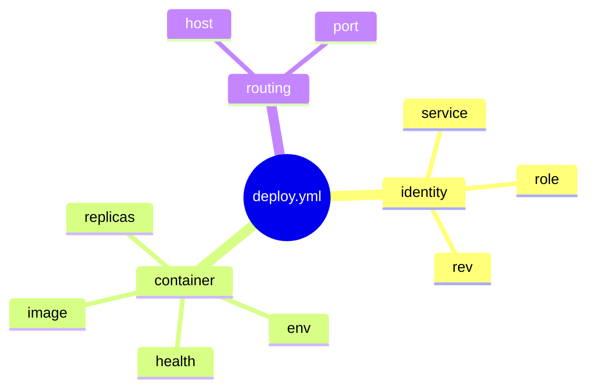

# Your first service

**What you get:** you can read every line of `deploy.yml`, say which fields change the container
and which change routing, and validate a change before any host sees it.

**Why it matters:** the file is the whole contract. Once you can read it, you can predict what a
deploy will do — and validation catches most mistakes locally, for free.

## The file, field by field

This is the complete file from the quick start, with a role, an environment variable and an
explicit health check added:

```yaml
version: 2
service: hello                 # identifier: letters, digits, - or _
role: web                      # defaults to web
image: traefik/whoami:v1.10    # the host pulls this, or --local-image streams it
hosts: [root@box.example.com]  # user@host:port forms are allowed
env:
  vars:
    BUNDANT_DEMO: "1"          # merged into the container environment, never printed
healthcheck:
  path: /                      # probed by a throwaway sidecar before traffic moves
  timeout: 30
proxy:
  enabled: true
  host: hello.bundant.test     # Host header that selects this service
  port: 80                     # port the proxy targets
```

The mind map groups the fields by what they change. **Container side** decides what process runs;
**routing side** decides which HTTP requests reach it; identity and placement decide where it runs
and what it is called.



| field | what it decides |
|---|---|
| `service` / `role` | the name: `<group>.<service>.<role>.<revision>`; `role` is a segment for variants of one service, default `web` |
| `image` | what to run; no registry is required when you use `--local-image` |
| `hosts` | one or more ssh targets; `BUNDANT_HOSTS` overrides the list |
| `env` | environment variables (name/value pairs passed into the container); values never appear in output |
| `healthcheck` | the gate that must pass before the proxy points at the new container |
| `proxy` | `enabled: false` for workers; when enabled, `host` is required |

The value of `proxy.host` is the **route host**: the `Host:` header a request must carry for the
proxy to route it to this service. Two services on one host are told apart by that header, not by
a port.

Commit the edit. The new git short sha is the new revision:

```sh
git add deploy.yml
git commit -m 'add health, env and role'
```

## Validate before you deploy

```sh
bundant validate -f deploy.yml
```

```text
bundant validate: OK
  version: 2
  group: default
  service: hello
  role: web
  revision: 0f2c8cc (git short sha of ~/bundant-tutorial/app)
  container: default.hello.web.0f2c8cc
  proxy id: default.hello.web
  env path: ~/.bundant/env/default/hello-web.env
  lock key: default/hello
  round-trip: ok
```

Validation parses the file, checks every field and the composed name, and prints the identity a
deploy would use. It does not open an ssh connection and does not take the lock.

## Deploy

```sh
bundant deploy -f deploy.yml
```

```text
deploy hello/web rev=0f2c8cc -> root@box.example.com
[root@box.example.com] deploying default.hello.web.0f2c8cc
[root@box.example.com] pull skipped (present, policy=missing)
[root@box.example.com] network ok
[root@box.example.com] run ok: default.hello.web.0f2c8cc
[root@box.example.com] health gate passed (1 target(s))
[root@box.example.com] proxy-ensure ok
[root@box.example.com] proxy-swap ok
[root@box.example.com] stop-old ok
deployed default.hello.web.0f2c8cc on 1 host(s)
```

What the phases mean:

- **pull** — the host already had the image, so this was a no-op. Without a registry,
  `--local-image` streams it over the same ssh connection.
- **network** — the shared `bundant` network exists.
- **run** — the new container starts with `--restart unless-stopped`; it publishes no host port.
- **health gate** — a throwaway sidecar requests `healthcheck.path`; a failure aborts before
  traffic moves.
- **proxy-ensure / proxy-swap** — the proxy container is running, then its target set is swapped
  in one call and old connections drain.
- **stop-old** — the previous revision is stopped, not removed; it is the rollback material.

```sh
bundant history -f deploy.yml
```

```text
== root@box.example.com (hello-web) ==
 * default.hello.web.0f2c8cc 1 replica    Up                       2026-10-20 21:31:44 +0000 UTC
   default.hello.web.11a45b2 1 replica    Exited (2) Less than a second ago 2026-10-20 21:31:42 +0000 UTC
  * = running revision
```

You should see `health gate passed` followed by `proxy-swap ok` and
`deployed ... on 1 host(s)`; `history` marks the new revision with `*` and keeps the old one
stopped.

## What actually happens

Validate runs the same zod preflight that every mutating command runs — before it creates an ssh
executor or takes the lock — so an invalid file causes zero host contact. Deploy then builds a
typed `ContainerSpec` (image, merged env, labels `bundant.kind`/`bundant.revision`/
`bundant.replica`) and posts it to `/containers/create`; `healthcheck.port` defaults to
`proxy.port`. The proxy route id is stable across revisions: `<group>.<service>.<role>`. See
[Validation](/bundant/docs/validation/), the
[deploy.yml reference](/bundant/docs/deploy-yml/) and
[Architecture](/bundant/docs/architecture/).

## Did it fail?

- **A typo in a field name** — unknown keys are rejected. This is a real validation failure:

  ```text
  bundant validate: FAILED (1 error(s))
    version: 2
    - (root): Unrecognized key(s) in object: 'helthcheck'
  ```

  Rename it to `healthcheck` and validate again.
- **`proxy.host is required when proxy.enabled is true`** — either add the `Host` name your
  service answers on, or set `proxy: { enabled: false }` for a worker that publishes no route.
- **The image cannot be pulled** — the error names the image and the host. Check that the tag
  exists and, on a private registry, that the host is already logged in.

Next: [Chapter 3 — Operate](/bundant/docs/tutorial/03-operate/).
